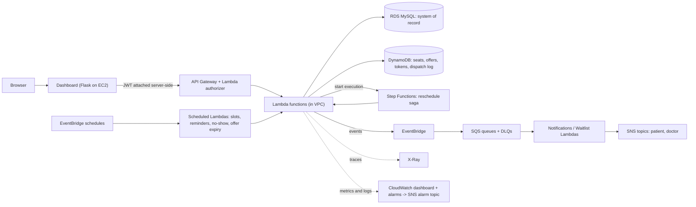

# Architecture

## Four flows to explain
1. **Booking.** Patient calls `POST /appointments` with an `Idempotency-Key`. A DynamoDB conditional update takes a seat only while `booked_count < capacity`; then the appointment row is written to RDS and `AppointmentBooked` is published.
2. **Reschedule saga (Step Functions).** Claim the target seat, then release the original seat. If the release fails, a compensation branch frees the claimed seat again, so the patient always holds exactly one appointment. Attempt limit and the 6-hour cutoff come from SSM parameters.
3. **Waitlist.** When a seat frees (`SlotSeatFreed`), the first waitlisted patient gets a hold offer. A conditional write allows only one live offer per seat and hides the seat from normal booking. Accepting converts the hold to a confirmed appointment; an expiry sweeper passes an unaccepted offer to the next patient.
4. **Notifications.** Every appointment event goes EventBridge → SQS (buffer, with a DLQ) → Lambda → SNS. A DynamoDB conditional write (the dispatch log) is done before publishing, so retries and double-triggered reminders never send twice.

## Schedules (EventBridge)
| Schedule | Job |
|---|---|
| nightly | Slot materialiser generates slots from availability patterns |
| every minute | Offer expiry sweeper |
| every 5 minutes | Reminders (24 h and 2 h before) |
| every 15 minutes | No-show sweeper |

## Configuration is not hard-coded
Refund tiers, reschedule limit and cutoff, waitlist cap and hold time, reminder hours and the no-show grace period are SSM parameters under `/medislot/<env>/...` (created in `data-stack.yaml`).
Notification and alarm e-mail addresses are GitHub secrets, never committed.
